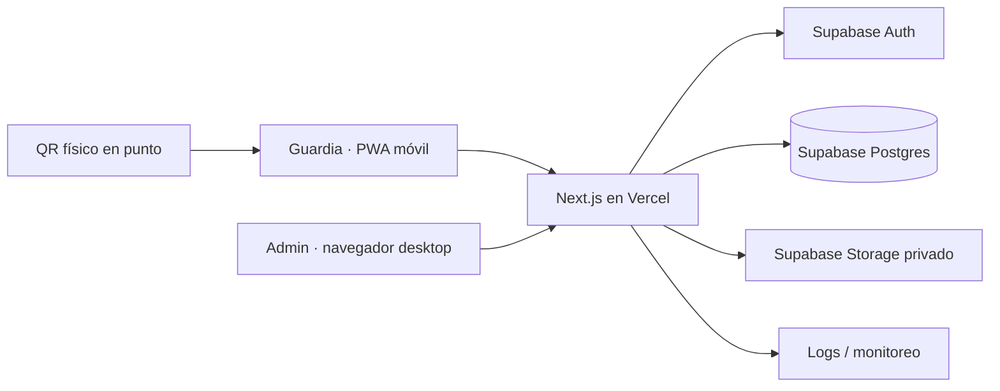
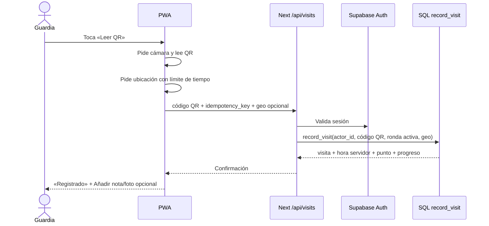
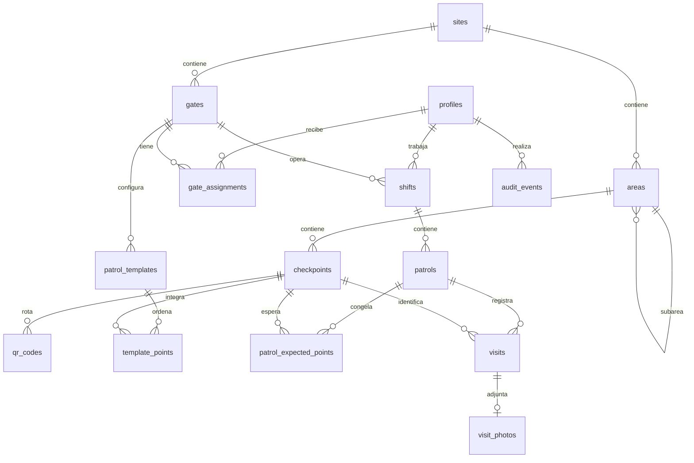

# K66 Rondas — guía para construir el MVP

**Versión:** 1.1 · **Fecha:** 10 de noviembre de 2026 · **Público:** desarrollador junior, líder de operaciones y responsable del piloto.

> **Qué se entrega aquí:** plano de producto, arquitectura, datos, interfaz, seguridad, despliegue, pruebas, métricas y backlog ejecutable. El repositorio ya contiene la base de las Fases 1 y 2: Next.js, `/styleguide`, Auth SSR, panel de configuración, QR imprimibles, migraciones y pruebas. El registro de visitas se construye en la Fase 3.

## 1. Decisiones y supuestos

**Nombre definido por el propietario: K66 Rondas.** Identificador técnico recomendado: `k66-rondas`. Configurar el dominio real cuando esté disponible; los ejemplos de URL de esta guía usan `DOMINIO` como marcador.

**Objetivo del MVP:** saber quién recorrió qué puntos físicos, en qué ronda, a qué hora, en qué garita, con observación y foto opcionales; permitir supervisión y exportación. El guardia debe poder registrar un punto en pocos segundos.

**Decisiones confirmadas por el propietario:** normalmente hay conexión; los dispositivos pueden ser compartidos, pero cada guardia tendrá una cuenta personal; aún no hay frecuencia obligatoria definida. El panel debe permitir crear y administrar tantos QR estáticos como se necesiten para nuevas áreas. **No se implementará RLS en este MVP.** Por eso el MVP confirma escrituras en línea, exige cambio de usuario al relevo, concentra el acceso a datos en el servidor y no presenta «ronda incumplida» sin una programación formal.

**Definiciones que evitan confusiones:**

| Término | Significado |
|---|---|
| Planta/sede | Fábrica o recinto físico. |
| Garita | Equipo operativo, como Central, Anexa, Palín o Escocesa. |
| Área | Ubicación lógica: edificio, sección, pasillo, bodega, etc. Puede tener área padre. |
| Punto de control | Ubicación concreta con un QR pegado. Pertenece a un área. |
| Plantilla de ronda | Lista ordenada de puntos que se esperan recorrer desde una garita. |
| Turno | Periodo de trabajo de un guardia en una garita. |
| Ronda | Recorrido iniciado dentro de un turno; conserva una copia de sus puntos esperados. |
| Visita | Escaneo aceptado de un punto durante una ronda. Es el registro auditable. |

**MVP incluido:** acceso individual, cambio de cuenta en móvil compartido, selección/inicio de turno, escaneo QR, registro inmediato con hora del servidor, ubicación lógica y geolocalización opcional, nota/foto opcionales, estado de ronda, historial propio, panel admin, configuración de sedes/garitas/áreas/puntos/plantillas, gestión de usuarios, creación ilimitada a nivel de producto de puntos y QR estáticos, reimpresión/rotación, filtros/exportación, analíticas básicas, PWA instalable y `/styleguide`. El volumen real dependerá del plan de infraestructura y se atenderá con paginación e índices, sin un máximo codificado en la aplicación.

**Después del piloto:** programación obligatoria y alertas por incumplimiento, modo sin conexión con cola verificable, geocercas, firma/NFC/BLE, integración de nómina, BI avanzado, notificaciones push. No prometer estas funciones en la venta inicial.

## 2. Decisiones de producto que se deben validar en planta

Antes del primer sprint, operaciones debe entregar un mapa de sedes, garitas y puntos, los nombres oficiales y fotos de ubicación. Hacer una caminata real con un guardia: medir cobertura de red, distancia de lectura, iluminación y guantes. Definir quién puede ver varias garitas y quién corrige nombres/QR. Confirmar política interna de fotos, geolocalización y retención. Estas decisiones cambian parámetros, no la arquitectura.

Un QR estático demuestra que se presentó un código, **no prueba por sí solo presencia física**: se puede fotografiar y compartir. Usar identificadores opacos aleatorios, registrar tiempo/usuario, detectar patrones sospechosos y permitir rotación del QR. Si la empresa exige prueba resistente al fraude, diseñar una segunda fase con QR dinámico, NFC o supervisión adicional. La posición GPS dentro de edificios puede faltar o ser imprecisa; conservar `accuracy_m` y tratarla como evidencia auxiliar, no como motivo automático de rechazo. [MDN explica permisos y precisión variable](https://developer.mozilla.org/en-US/docs/Web/API/Geolocation_API/Using_the_Geolocation_API).

## 3. Arquitectura elegida

Una sola app Next.js (App Router, TypeScript) sirve `/app` para guardias, `/admin` para administración y `/styleguide` para el sistema visual. Next.js ofrece rutas, componentes de servidor y handlers de API dentro del mismo proyecto. [Documentación de App Router](https://nextjs.org/docs/app).



| Capa | Elección | Motivo y límite |
|---|---|---|
| Web y servidor | Next.js + TypeScript + Node runtime | Un repositorio y despliegue sencillo; rutas privadas y API. |
| Datos/autenticación/archivos | Supabase Postgres, Auth, Storage | Identidad individual, SQL relacional, fotos privadas. |
| Acceso a datos | `@supabase/ssr` para sesión; `supabase-js` con clave secreta solo en servidor; SQL versionado | El navegador usa Auth y rutas Next.js, sin consultar tablas directamente. Sin RLS. [Guía SSR](https://supabase.com/docs/guides/auth/server-side/creating-a-client?framework=nextjs). |
| Escaneo | `@zxing/browser`, `BrowserQRCodeReader` | Lector QR en cámara; detener cámara al salir. [API oficial](https://github.com/zxing-js/browser). |
| Interfaz | Tailwind CSS + shadcn/ui + Radix + Lucide | Componentes accesibles que el equipo puede adaptar. [shadcn/ui](https://ui.shadcn.com/docs). |
| Formularios | React Hook Form + Zod | Validación compartida de entradas y mensajes claros. |
| Fechas | `Intl.DateTimeFormat` + UTC en BD | Mostrar zona de la planta; no guardar texto de fecha local. |
| E2E | Playwright + Vitest para lógica pura | Probar móvil y admin. [Playwright permite emulación móvil](https://playwright.dev/docs/emulation). |
| Hosting | Vercel + proyecto Supabase por ambiente | Previews, HTTPS, variables separadas. [Ambientes Vercel](https://vercel.com/docs/deployments/environments). |

**Prisma:** no se añade al MVP. Supabase Auth, funciones SQL y migraciones ya forman el modelo de datos; sumar Prisma introduciría otra capa de esquema y conexiones que el junior tendría que mantener. Reconsiderarlo si aparecen consultas servidor complejas. [Prisma documenta conexiones agrupadas para tráfico y directas para migraciones](https://www.prisma.io/docs/orm/prisma-client/setup-and-configuration/databases-connections).

**Zustand:** tampoco es necesario al inicio. Estado de escáner, foto y modal vive en componentes; datos persistentes se leen del servidor. Añadirlo cuando existan estados compartidos complejos entre pantallas, con un caso medido. Evitar duplicar la base de datos en memoria.

### 3.1 Límites de confianza

1. La app nunca acepta `guard_id`, `recorded_at`, nombre de punto ni nombre de garita enviados por el navegador como autoridad.
2. El servidor obtiene identidad desde Supabase Auth y consulta perfil/garita/turno activo.
3. El QR contiene un código opaco aleatorio que la base conserva para permitir reimprimir el mismo QR estático. La visita se crea mediante función SQL transaccional que verifica código, ronda y permisos.
4. El navegador no consulta las tablas operativas. Cada ruta Next.js valida sesión y rol/garita antes de usar la clave secreta Supabase. Esa clave jamás va al cliente. Sin RLS, dejar grants de `anon` o `authenticated` en tablas operativas expondría todos los registros a través de Data API: se revocan y se verifica el bloqueo. [Supabase documenta grants y exposición de Data API](https://supabase.com/docs/guides/api/securing-your-api).
5. El bucket de fotos es privado. Solo se entrega URL firmada de corta duración a alguien autorizado. [Storage privado](https://supabase.com/docs/guides/storage/buckets/fundamentals).

### 3.2 Ruta de un escaneo



La ubicación lógica viene del punto QR en la base. La geolocalización del dispositivo se pide con consentimiento y `timeout` corto (por ejemplo 4 segundos); si se rechaza o vence, se guarda `geo_status` y se sigue con el registro. `getUserMedia` y geolocalización requieren HTTPS/permisos; probar en móviles reales. [Cámara](https://developer.mozilla.org/en-US/docs/Web/API/MediaDevices/getUserMedia), [ubicación](https://developer.mozilla.org/en-US/docs/Web/API/Geolocation/getCurrentPosition).

### 3.3 QR físico y forma del contenido

El QR estático codifica `https://DOMINIO/scan/CODIGO_OPACO`. El lector integrado acepta esa URL y extrae el código; la cámara nativa del teléfono puede abrirla, pedir login si corresponde y continuar. Generar un código aleatorio de al menos 128 bits por punto, guardar el valor en `qr_codes.public_code` y usarlo para reimprimir exactamente el mismo QR cuando se deteriore. El código no contiene nombre, usuario, contraseña ni GPS. No es una credencial de acceso: la API exige sesión individual, turno y ronda válidos. Si se copia el papel, el código puede compartirse; la rotación invalida la versión antigua.

**Impresión:** código humano `CENT-BOD-03`, nombre legible, texto «Escanea con K66 Rondas», QR de al menos 30–40 mm según distancia/ambiente, contraste alto, laminado resistente y número de versión. El administrador prueba cada hoja antes de pegarla, anota ubicación física y retira versiones anteriores al rotar. Código humano es para soporte; no permite registrar manualmente una visita.

**Crecimiento sin límite fijo:** cada área puede tener muchos puntos; cada punto tiene un QR activo. Para añadir más QR en la misma área, el admin crea más puntos con códigos humanos distintos. La lista de áreas/puntos/QR usa búsqueda, filtros y paginación; ninguna tabla, formulario o regla de negocio fija un cupo máximo. La BD mantiene unicidad de códigos y un solo QR activo por punto.

## 4. Roles y gestión de usuarios de varias garitas

| Rol | Puede hacer | No puede hacer |
|---|---|---|
| Guardia | Iniciar/cerrar turno propio, escanear puntos permitidos, añadir nota/foto a visitas propias, ver su historial. | Crear usuarios, editar hora/punto/autor, consultar otras garitas. |
| Supervisor | Ver rondas, filtros y métricas de sus garitas; gestionar incidencias operativas si se autoriza. | Administrar sedes ajenas o asignar permisos globales. |
| Administrador | Gestionar sedes, garitas, puntos, plantillas, usuarios, QR, reportes y configuración. | Cambiar evidencia histórica silenciosamente. |

**Recomendación central:** una cuenta **por persona**, incluso si el teléfono es de la garita. El identificador autenticado `auth.users.id` queda en turno, ronda y visita. La garita se elige al iniciar turno entre las asignadas al usuario; se guarda una copia en turno/ronda para reportes históricos. Una cuenta compartida de «Garita Central» destruye la atribución personal y no se usa.

**Alta sin correo personal:** el admin crea un código único de empleado (`G-0042`) y una identidad de Auth con email interno no entregable y contraseña temporal aleatoria. El formulario pide «Código de empleado» y contraseña; una ruta de servidor resuelve el código a la identidad Auth con cliente administrativo, luego inicia sesión mediante cliente SSR que escribe cookies. No expone la lista de cuentas ni revela si existe el código. Usar los límites de intentos de Supabase Auth y revisar su configuración para que el tráfico del servidor no comparta accidentalmente una sola cuota. El guardia cambia la contraseña en primer acceso. Alternativa preferida cuando haya correo individual: invitación de Supabase Auth. Para recuperación sin correo, el admin verifica presencialmente identidad y emite nueva contraseña temporal. Nunca usar PIN de 4 dígitos como único factor. [Creación administrativa](https://supabase.com/docs/reference/javascript/auth-admin-createuser) y [límites de Auth](https://supabase.com/docs/guides/auth/rate-limits).

**Móvil compartido:** tras terminar turno, botón visible «Cerrar turno y salir»; siguiente persona inicia sesión. No autocompletar credenciales ni guardar contraseña del guardia en el dispositivo. Tiempo de inactividad configurable y cierre de sesión al relevo. Mostrar siempre nombre y garita en cabecera para detectar cuenta equivocada. Si hay un turno activo del usuario en otro equipo, avisar y ofrecer cierre controlado. No permitir dos turnos abiertos del mismo guardia.

## 5. Modelo de datos

Convención: claves UUID, `created_at`/`recorded_at` como `timestamptz` UTC, borrado lógico (`active=false` o `archived_at`) en entidades que ya tengan evidencia, claves foráneas e índices. Guardar los nombres actuales en catálogos; guardar además `*_name_snapshot` en turno/ronda/visita cuando el nombre histórico sea necesario para exportación. La base define `recorded_at default now()` y el cliente nunca lo establece.



### 5.1 Diccionario de tablas

| Tabla | Columnas esenciales | Restricciones y uso |
|---|---|---|
| `sites` | `id`, `code`, `name`, `timezone`, `active`, `created_at` | `code` único; zona IANA, por ejemplo `America/Guatemala`. |
| `gates` | `id`, `site_id`, `code`, `name`, `active` | Único `(site_id, code)`; FK a sede. |
| `areas` | `id`, `site_id`, `parent_id?`, `code`, `name`, `active` | Árbol opcional; impedir ciclos y padre de otra sede. Único `(site_id, code)`. |
| `checkpoints` | `id`, `area_id`, `code`, `name`, `description?`, `active`, `installed_at?`, `last_verified_at?` | Único `(area_id, code)`; área autoritativa de la visita. |
| `qr_codes` | `id`, `checkpoint_id`, `public_code`, `version`, `created_at`, `revoked_at?`, `created_by` | Código aleatorio único y reimprimible; solo un QR activo por punto; las versiones anteriores quedan revocadas. |
| `profiles` | `id` = `auth.users.id`, `employee_code`, `full_name`, `role`, `active`, `must_change_password`, `created_at` | Código empleado único; `role in (guard, supervisor, admin)`. |
| `gate_assignments` | `id`, `profile_id`, `gate_id`, `active`, `assigned_at` | Único `(profile_id, gate_id)`; define garitas autorizadas. |
| `shifts` | `id`, `guard_id`, `gate_id`, `started_at`, `ended_at?`, `gate_name_snapshot` | Un solo turno abierto por guardia; guardia asignado a esa garita. |
| `patrol_templates` | `id`, `gate_id`, `name`, `is_default`, `active`, `created_at` | Una plantilla por defecto activa por garita; versionar o editar solo para rondas futuras. |
| `template_points` | `id`, `template_id`, `checkpoint_id`, `position`, `required` | Único punto y posición por plantilla; punto de la misma sede que la garita. |
| `patrols` | `id`, `shift_id`, `template_id`, `guard_id`, `gate_id`, `status`, `started_at`, `ended_at?`, `closure_reason?` | `status`: `in_progress`, `completed`, `incomplete`; una ronda abierta por turno. |
| `patrol_expected_points` | `id`, `patrol_id`, `checkpoint_id`, `position`, `required`, `checkpoint_name_snapshot`, `area_name_snapshot` | Copia inmutable al iniciar ronda; único `(patrol_id, checkpoint_id)`. |
| `visits` | `id`, `patrol_id`, `checkpoint_id`, `guard_id`, `gate_id`, `recorded_at`, `note?`, `note_updated_at?`, `geo_status`, `latitude?`, `longitude?`, `accuracy_m?`, `geo_captured_at?`, `idempotency_key`, `checkpoint_name_snapshot`, `area_name_snapshot` | Único `(patrol_id, checkpoint_id)` y `(guard_id, idempotency_key)`; no borrar ni reescribir autor/hora/punto. |
| `visit_photos` | `id`, `visit_id`, `storage_path`, `mime_type`, `bytes`, `uploaded_at`, `uploaded_by` | Una foto por visita en MVP; bucket privado; máximo 5 MB luego de compresión. |
| `audit_events` | `id`, `actor_id?`, `action`, `entity_type`, `entity_id?`, `occurred_at`, `metadata jsonb` | Append-only; sin contraseñas, códigos QR, coordenadas precisas ni URL firmadas. |
| `site_settings` | `site_id`, `idle_logout_minutes`, `photo_retention_days`, `geo_enabled`, `updated_at` | Configuración validada; frecuencia obligatoria se añade cuando exista política. |

**Índices mínimos:** `visits(recorded_at desc)`, `visits(gate_id, recorded_at desc)`, `visits(guard_id, recorded_at desc)`, `patrols(gate_id, started_at desc)`, `shifts(guard_id, started_at desc)`, `gate_assignments(gate_id, active)`, `checkpoints(area_id, active)` y `qr_codes(public_code)` único. Índices parciales: `unique (guard_id) where ended_at is null` en turnos, `unique (shift_id) where status='in_progress'` en rondas, `unique (checkpoint_id) where revoked_at is null` en QR. Agregar `check` de latitud `[-90,90]`, longitud `[-180,180]`, precisión positiva, nota ≤ 1000 caracteres. FKs con `on delete restrict` en evidencia.

**Relaciones de sitio:** una garita y sus plantillas pertenecen a la misma sede que sus puntos; validar al editar plantilla y en función SQL. Cambios de sede de un punto usado no se permiten: archivar y crear otro. El área física y el código QR pueden tener múltiples versiones; las visitas históricas conservan su identidad.

### 5.2 Permisos de base y operación atómica

**Sin RLS en el MVP:** el navegador utiliza Supabase Auth para iniciar sesión, pero nunca `from(...)` ni `rpc(...)` sobre tablas operativas. Todas las lecturas y escrituras van a rutas Next.js. Cada ruta verifica la sesión, consulta el rol y las garitas asignadas, filtra por ese alcance y solo entonces usa un cliente Supabase con clave secreta en servidor. El admin puede gestionar todo; el supervisor solo sus garitas; el guardia solo sus propios turnos/rondas/visitas.

**Cierre básico del Data API:** revocar `select/insert/update/delete` de las tablas operativas para los roles `anon` y `authenticated`, y conceder los permisos necesarios a `service_role`. Revocar `execute` de las funciones operativas a `PUBLIC`, `anon` y `authenticated`, concediéndolo a `service_role`. Hacerlo en las migraciones de cada tabla/función y verificarlo con una petición directa usando la clave pública: debe responder `permission denied`. Sin RLS, esta medida es indispensable porque Supabase puede exponer tablas del esquema `public` si tienen grants de cliente. No afecta a Supabase Auth. [Grants y Data API](https://supabase.com/docs/guides/api/securing-your-api), [claves y roles](https://supabase.com/docs/guides/getting-started/api-keys).

Crear la función `record_visit(actor_id uuid, qr_code text, idempotency_key uuid, geo jsonb)` en una migración. Se llama únicamente desde `/api/visits` con clave secreta, después de validar la identidad en servidor; la función vuelve a comprobar perfil, garita y turno. No requiere `security definer` ni `auth.uid()`. Una llamada RPC ejecuta la función dentro de una transacción. Pasos:

1. Rechazar código mal formado, perfil inactivo, usuario que no sea guardia y entrada geo fuera de rango.
2. Buscar `qr_codes.public_code` activo y su punto. No revelar al cliente si un código ajeno existe.
3. Bloquear la ronda activa y verificar turno abierto, guardia propietario, garita asignada, punto esperado y punto activo.
4. Si ya existe `(guard_id, idempotency_key)`, devolver la misma visita y marcar resultado idempotente. Si ese punto ya fue leído en la ronda con otra clave, devolver `already_scanned` sin nueva visita.
5. Insertar visita con `now()` del servidor y snapshots de área/punto. No usar tiempo, área ni guardia enviados por cliente.
6. Si se visitaron todos los puntos esperados, marcar ronda `completed` con `ended_at=now()`. Si solo faltan puntos opcionales, permitir que el guardia pulse «Terminar ronda»: se marca `completed` porque todos los requeridos fueron visitados; guardar cuántos opcionales quedaron sin visitar. Nunca cerrar automáticamente al último requerido si aún quedan opcionales que el guardia pueda visitar.
7. Devolver identificador, hora, nombre de punto y progreso. No devolver el código QR en la respuesta de visita.

**Nota/foto:** tras la respuesta exitosa mostrar tarjeta de éxito y acciones opcionales. Nota: endpoint valida autor y ventana de edición de 15 minutos; guarda `note_updated_at` y un evento de auditoría. Después solo admin puede añadir una corrección separada en auditoría, sin cambiar evidencia original. Foto: endpoint emite carga firmada para ruta `site/visit/uuid.jpg`, el cliente comprime, sube y confirma; se valida tipo/tamaño y propiedad de visita. Si falla la foto, la visita sigue registrada. Limpiar objetos subidos sin confirmación. Si una foto se elimina por retención, conservar metadatos de visita y evento de purga.

### 5.3 Horarios, ubicación y consistencia

Todos los tiempos en `timestamptz` UTC; mostrar con la zona de la sede y exportar ISO 8601 más zona. Guardia no puede cambiar hora. Registrar hora del servidor aunque reloj móvil esté incorrecto. `geo_status`: `captured`, `denied`, `timeout`, `unavailable`, `disabled`; si capturada, guardar lat/lon, `accuracy_m` y momento de captura. La vista admin muestra coordenadas únicamente a roles autorizados y las etiqueta «ubicación del dispositivo, precisión aproximada».

La ronda conserva puntos esperados al inicio. Si el admin edita una plantilla en medio de un turno, no cambia las rondas ya iniciadas. La ronda incompleta puede cerrarse con motivo; no inventar «completada». Al cerrar turno, si hay ronda abierta, pedir decisión explícita: terminarla incompleta o continuar antes de salir.

## 6. API y contratos

| Ruta | Método | Entrada | Respuesta / autorización |
|---|---|---|---|
| `/api/auth/login-code` | POST | código, contraseña | Resuelve identidad de forma segura; sesión o error genérico; rate limit. |
| `/api/shifts` | POST | `gate_id` | Turno abierto del usuario autenticado asignado; solo guardia. |
| `/api/shifts/current` | GET | — | Turno y ronda activos, progreso. |
| `/api/shifts/:id/close` | POST | motivo si hay ronda abierta | Cierra turno propio; audita. |
| `/api/patrols` | POST | `template_id?` | Inicia ronda; si solo hay una plantilla, usar default. |
| `/api/patrols/:id/close` | POST | `completed` o `incomplete` + motivo | Valida cobertura y propietario. |
| `/api/visits` | POST | Código QR, `idempotency_key`, geo opcional | Valida sesión y llama `record_visit`; respuesta idempotente. |
| `/api/visits/:id/note` | PATCH | nota | Solo autor dentro de 15 min; audita. |
| `/api/visits/:id/photo-upload` | POST | tipo, tamaño | URL de carga firmada para visita propia. |
| `/api/visits/:id/photo-confirm` | POST | ruta de objeto | Verifica objeto y enlaza foto. |
| `/api/admin/users` | GET/POST | filtros o datos de alta | Solo admin; alta con Auth Admin server. |
| `/api/admin/checkpoints` | GET/POST | filtros o área, nombre, código humano | Lista paginada o crea nuevos puntos sin cupo de producto; solo admin. |
| `/api/admin/checkpoints/:id/qr` | GET/POST | GET reimprime; POST rota con motivo | Devuelve URL/arte imprimible del QR activo o revoca y genera otra versión; audita. |
| `/api/admin/visits/export` | GET | filtros con rango máximo | CSV UTF-8 con BOM, zona horaria y permisos. |

Todas las entradas con Zod, mensajes de error estables (`NOT_AUTHENTICATED`, `FORBIDDEN`, `NO_ACTIVE_SHIFT`, `INVALID_QR`, `ALREADY_SCANNED`, `NETWORK_ERROR`) y `request_id` para soporte. Filtros con paginación por cursor o página, límite de 50 filas y rango de exportación acotado. Los endpoints que modifican datos verifican sesión en servidor, método y origen; no confían en botón oculto. El cliente usa `idempotency_key` nuevo por intento real, mantiene la misma clave al reintentar una respuesta incierta. Si esa clave se reutiliza con otro QR, devolver conflicto.

## 7. Estructura del repositorio y mapas de rutas

```text
k66-rondas/
├─ README.md                         # instalación rápida y enlaces
├─ .env.example                      # nombres de variables, sin secretos
├─ package.json
├─ next.config.ts
├─ playwright.config.ts
├─ src/
│  ├─ app/
│  │  ├─ layout.tsx                   # metadata, fuentes, providers
│  │  ├─ manifest.ts                 # nombre, iconos, display standalone
│  │  ├─ icon.png / apple-icon.png
│  │  ├─ (auth)/login/page.tsx
│  │  ├─ (auth)/change-password/page.tsx
│  │  ├─ (guard)/app/layout.tsx      # guardia + navegación móvil
│  │  ├─ (guard)/app/page.tsx         # inicio/turno/progreso
│  │  ├─ (guard)/app/scan/page.tsx    # cámara, QR externo, confirmación
│  │  ├─ (guard)/app/history/page.tsx
│  │  ├─ (guard)/app/history/[id]/page.tsx
│  │  ├─ (admin)/admin/layout.tsx    # sidebar + permisos
│  │  ├─ (admin)/admin/page.tsx       # dashboard
│  │  ├─ (admin)/admin/visits/page.tsx
│  │  ├─ (admin)/admin/patrols/page.tsx
│  │  ├─ (admin)/admin/users/page.tsx
│  │  ├─ (admin)/admin/gates/page.tsx
│  │  ├─ (admin)/admin/areas/page.tsx
│  │  ├─ (admin)/admin/checkpoints/page.tsx
│  │  ├─ (admin)/admin/templates/page.tsx
│  │  ├─ (admin)/admin/analytics/page.tsx
│  │  ├─ (admin)/admin/settings/page.tsx
│  │  ├─ styleguide/page.tsx
│  │  ├─ api/...                      # contratos de sección 6
│  │  └─ scan/[code]/page.tsx         # acceso desde cámara nativa
│  ├─ components/
│  │  ├─ ui/                          # shadcn adaptado
│  │  ├─ guard/                       # Scanner, Progress, VisitSuccess
│  │  ├─ admin/                       # Filters, Tables, Charts
│  │  └─ shared/                      # EmptyState, ConfirmDialog, StatusBadge
│  ├─ features/
│  │  ├─ auth/                        # validaciones y casos de uso
│  │  ├─ shifts/
│  │  ├─ patrols/
│  │  ├─ visits/
│  │  ├─ checkpoints/
│  │  └─ analytics/
│  ├─ lib/
│  │  ├─ supabase/browser.ts
│  │  ├─ supabase/server.ts
│  │  ├─ supabase/admin.ts            # solo servidor
│  │  ├─ authz.ts                     # permisos por rol/garita
│  │  ├─ qr.ts                        # parseo y validación
│  │  ├─ dates.ts                     # UTC y zona de sede
│  │  └─ errors.ts
│  ├─ types/database.ts              # tipos generados Supabase
│  └─ proxy.ts                       # refresco de sesión en Next.js 16+
├─ supabase/
│  ├─ config.toml
│  ├─ migrations/                    # esquema, grants, funciones, storage
│  ├─ seed.sql                        # solo datos ficticios locales
│  └─ tests/                          # pruebas SQL de record_visit
├─ tests/e2e/
├─ public/icons/                     # 192, 512, maskable, apple
└─ docs/
   ├─ GUIA_MVP.md
   ├─ ADR/                          # decisiones de arquitectura
   └─ operaciones/                   # instalación QR y soporte
```

**Mapa de navegación:**

```mermaid
flowchart TD
  L[Login] --> C{Rol}
  C -->|Guardia| H[Inicio /app]
  H --> T[Iniciar turno]
  T --> S[Escanear /app/scan]
  S --> OK[Éxito + nota/foto opcional]
  H --> HI[Mi historial]
  C -->|Supervisor o admin| D[Panel /admin]
  D --> V[Visitas y rondas]
  D --> AN[Analíticas]
  D --> CFG[Usuarios, garitas, puntos, plantillas, ajustes]
  C -->|Diseño interno| ST[/styleguide]
```

## 8. Webapp del guardia: pantallas y microinteracciones

**Login:** logo, título «Tu ronda empieza aquí», código de empleado, contraseña con mostrar/ocultar, botón principal, error genérico y ayuda de recuperación presencial. Nunca mostrar una lista de guardias en el teléfono compartido.

**Primer acceso:** cambiar contraseña temporal, confirmar cambio, explicar «esta cuenta registra tus visitas». No comenzar turno antes de cambiarla.

**Inicio `/app`:** saludo con nombre, chip de garita, estado de turno, CTA fijo «Leer QR» (si hay turno activo) o «Iniciar turno», progreso `3 de 7 puntos`, lista de siguientes puntos, último registro confirmado con hora. Si no hay ronda activa y existe una plantilla por defecto, «Leer QR» la inicia automáticamente antes de registrar el primer punto; si hay varias, pedir plantilla una vez. La lista no debe exigir seguir orden salvo que operaciones lo requiera expresamente.

**Escáner:** cámara posterior a pantalla casi completa, guía visual, linterna si hardware la admite, instrucción breve, botón cerrar, estado de permiso. Bloquear múltiples detecciones mientras se procesa, detener `MediaStreamTrack` al cerrar/desmontar. Mostrar ubicación obtenida o «sin ubicación del dispositivo» sin detener la visita. Un QR inválido muestra diálogo «No reconocemos este punto» y botón «Intentar de nuevo». Si la red falla, conservar código y clave de idempotencia en memoria de la pantalla, ofrecer «Reintentar»; no afirmar que se guardó. Si se cierra la app antes de confirmar, el guardia deberá volver a escanear. Al abrir `/scan/[code]` desde la cámara nativa, conservar esa ruta durante el login y procesarla después de autenticar.

**Éxito:** hoja inferior accesible: ✅ «Punto registrado», nombre, área, hora del servidor y progreso. Acciones secundarias «Añadir observación», «Añadir foto» y CTA «Continuar ronda». No obligar a llenar campos antes de guardar. Si se detecta punto ya leído, mostrar «Ya registrado en esta ronda» y hora previa, sin nueva visita.

**Historial:** filtros ligeros Hoy / Ayer / 7 días, tarjetas por ronda con estado y puntos, detalle de visita con nota/foto si existe; no editar autor, hora ni área. **Perfil:** nombre/código, garitas asignadas, contraseña, cierre de turno y salida.

**Estados que deben diseñarse:** carga, vacío, éxito, duplicado, QR vencido, sin turno, sin permisos de cámara, sin ubicación, sin red, foto fallida, sesión caducada, cambio de guardia. Confirmar acciones destructivas con diálogo amigable; éxito rutinario con hoja breve o toast, sin modal que frene cada escaneo.

### 8.1 Flujos eficientes por rol

| Actor y objetivo | Flujo mínimo | Resultado verificable |
|---|---|---|
| Guardia inicia jornada | Login → elige garita asignada → «Iniciar turno». | Nombre y garita visibles; turno abierto. |
| Guardia registra punto | «Leer QR» → cámara → QR → confirmación. | Visita en BD y progreso actualizado sin formulario obligatorio. |
| Guardia agrega incidencia | Tras éxito → nota y/o foto → guardar → continuar. | Evidencia vinculada, fallo de foto no borra visita. |
| Guardia termina | Revisa cobertura → cierra ronda si procede → cierra turno → sale. | Turno cerrado y cuenta ajena no queda abierta. |
| Supervisor verifica | Dashboard filtrado por garitas → ronda incompleta → detalle. | Puntos faltantes y autor claros. |
| Admin prepara planta | Sede → garitas → áreas → puntos → plantillas → imprimir QR → prueba. | Puntos activos y QR validados en sitio. |
| Admin da alta/releva | Crea cuenta → asigna garitas → entrega acceso individual → desactiva al retiro. | Registro conserva identidad histórica. |

## 9. Panel admin: estructura funcional

**Layout desktop:** sidebar de 240 px, cabecera con planta/garita, búsqueda, usuario; en móvil menú compacto. Inicio con tarjetas de visitas hoy, rondas en curso, rondas completadas/incompletas, cobertura de puntos; lista reciente y estados. Cada tarjeta abre el filtro correspondiente.

| Sección | Funciones del MVP |
|---|---|
| `Visitas` | Tabla con hora local/UTC exportable, guardia, garita, área, punto, ronda, geo, nota/foto; filtros fecha, sede, garita, guardia, área, punto, con foto, estado geo; detalle sin edición silenciosa; CSV. |
| `Rondas` | Tabla estado/progreso/duración, detalle de puntos esperados y visitados, cierre incompleto con motivo y trazabilidad. |
| `Usuarios` | Alta individual, credencial temporal, cambio de rol, asignación a varias garitas, activación/desactivación, reset presencial, último acceso. No mostrar contraseña después de entrega. |
| `Garitas y áreas` | CRUD controlado de sedes, garitas, jerarquía de áreas; archivar en vez de borrar si hay visitas. |
| `Puntos QR` | Crear tantos puntos como se necesiten en cualquier área, uno a uno o por carga CSV opcional; generar QR estático automáticamente, visualizar, descargar/imprimir, reimprimir el mismo código, probar lectura, editar ubicación/nombre, archivar y rotar con motivo. Búsqueda, filtros por sede/garita/área/estado y paginación; mostrar versión y verificación física. |
| `Plantillas` | Ordenar puntos, indicar requeridos/opcionales y default por garita; previsualizar ruta y validar que haya puntos. |
| `Analíticas` | Tendencia diaria/semanal, cobertura por garita/plantilla/guardia, duración mediana, duplicados/errores, exportación. Filtros y definiciones visibles. |
| `Configuración` | Zona horaria de sede, política de fotos/geo, tiempo de inactividad, retención, datos de soporte, acceso a `/styleguide` interno. |

**Permisos:** supervisor ve solo garitas asignadas, y no accede a gestión global. Admin inicial es creado manualmente por un operador técnico seguro; nunca existe registro público de administradores. En tablas grandes, paginar en servidor, filtros en URL para compartir vista y estado vacío que explique qué filtro no produjo resultados. Exportación respeta el mismo alcance de permisos.

### 9.1 Operación de QR desde el panel

1. El admin entra en **Puntos QR** y selecciona sede y área existentes; si el área no existe, la crea allí mismo y vuelve al formulario.
2. Escribe código humano y nombre del punto, descripción física opcional y guarda. El servidor crea `checkpoints` y su primera fila `qr_codes` con código aleatorio único; la pantalla muestra vista previa de la etiqueta.
3. Descarga PDF para imprimir o imprime desde el navegador. Puede **reimprimir el mismo QR** cuantas veces haga falta sin generar una versión nueva.
4. Prueba el QR pegado con un móvil y marca «Verificado en sitio», guardando fecha y usuario verificador.
5. Cuando aparece una nueva ubicación, repite el proceso: no hay límite fijo de áreas, puntos o códigos en la lógica del producto. La tabla paginada evita cargar todos los QR a la vez.
6. Si el papel se pierde o el código se divulga, pulsa «Rotar QR», confirma motivo y obtiene nueva versión. El código anterior queda revocado; las visitas históricas siguen vinculadas al mismo punto.

El panel no permite borrar un punto que tiene visitas; se archiva. Al archivar un punto, la API deja de aceptar su QR. Si un área tiene varias ubicaciones que deben verificarse por separado, crear varios puntos en esa área, cada uno con su propio QR.

## 10. `/styleguide`: especificación implementable

La ruta será una página viva de componentes reales. Acceso interno en producción (admin), abierta en desarrollo. Cada componente se muestra con estados normal, hover, focus, disabled, loading y error; incluir una tarjeta de guardia móvil y una tabla admin desktop con datos ficticios.

**Dirección visual:** limpia, cálida y confiable, con fondo marfil muy suave y superficies blancas. Emplear emoji solo como apoyo semántico en mensajes («✅», «📍», «📷»), nunca como único indicador ni en controles de navegación. Íconos Lucide consistentes de 20–24 px.

| Token | Valor inicial | Uso |
|---|---|---|
| `--background` | `#F6F8F7` | Fondo general. |
| `--surface` | `#FFFFFF` | Cards, sheets, tablas. |
| `--text` | `#18252A` | Texto primario. |
| `--muted` | `#5D6D72` | Texto secundario. |
| `--primary` | `#087F68` | CTA, foco y progreso. |
| `--primary-foreground` | `#FFFFFF` | Texto sobre primario. |
| `--success` | `#157347` | Confirmaciones. |
| `--warning` | `#A56108` | Incompleta/pendiente. |
| `--danger` | `#B42318` | Errores y acciones delicadas. |
| `--border` | `#DCE5E2` | Separadores. |
| Radius | `12px` inputs, `16px` cards, `20px` sheets | Consistencia táctil. |
| Espaciado | escala 4/8/12/16/24/32 px | Ritmo de pantalla. |

**Tipografía:** `Inter` o `Geist` con fallback de sistema; cuerpo 16 px/24 px en móvil, títulos 24–30 px y números de progreso 32 px. Alto táctil mínimo 44 px; CTA primario 52–56 px. Contenedor guardia de máximo 480 px, padding móvil 16 px; admin ancho fluido con máximo 1440 px. Breakpoints de diseño 360, 390, 768 y 1280 px. No esconder funciones críticas únicamente por tamaño.

**Contenido de `/styleguide`:** colores y contraste; tipografía; botones (principal, secundario, peligro); inputs y validación; Select/Combobox; chips de estado; cards; tabla y filtros; progress; empty/error/loading; Dialog, AlertDialog, Sheet, Toast; iconografía; muestra PWA; escáner simulado; ejemplos de texto de confirmación. Revisar contraste WCAG AA, foco visible, labels y navegación por teclado. Para QR, probar cámara en hardware real además de emulación.

**Textos recomendados:** «Punto registrado»; «Ya registraste este punto en esta ronda»; «No pudimos guardar el registro. Reintenta cuando vuelva la conexión»; «Cierra sesión para entregar este teléfono al siguiente guardia». Evitar tecnicismos como «código inválido» frente al usuario.

## 11. PWA y despliegue

Crear `src/app/manifest.ts` con nombre, `short_name`, `start_url: '/app'`, `display: 'standalone'`, colores e iconos de 192/512 px y maskable; añadir `apple-icon.png`. Servir siempre con HTTPS. Next.js documenta manifiesto, instalación y particularidades de Safari iOS; el botón de instalación no funciona igual en todos los navegadores, así que mostrar instrucciones específicas si hace falta. [Guía PWA Next.js](https://nextjs.org/docs/app/guides/progressive-web-apps).

**Service worker del MVP:** cachear solo shell/activos estáticos necesarios; no cachear respuestas autenticadas, fotos, códigos QR ni `/api/*`. La instalación no equivale a soporte sin conexión para registrar visitas. Mostrar banner offline y bloquear confirmaciones hasta volver la red. Probar actualización de versión y limpieza de caché. Si se decide posponer service worker, validar instalación real en Android/iOS con manifiesto e iconos; incorporar el SW cuando se necesite experiencia offline de shell.

**Entornos:** local, staging y producción con proyectos Supabase separados y variables Vercel separadas. `.env.example`: `NEXT_PUBLIC_SUPABASE_URL`, `NEXT_PUBLIC_SUPABASE_PUBLISHABLE_KEY`, `SUPABASE_SECRET_KEY` (solo servidor), `APP_BASE_URL`, `SENTRY_DSN?` si se instala monitoreo. No usar claves de producción localmente ni incluir `.env.local` en Git. La clave pública es publicable; la secreta no.

**Preparación de despliegue:** crear proyecto Supabase en región cercana, configurar Auth (sin signup público, URLs de redirección, política de sesión), bucket privado `visit-photos` con límite/tipos, migraciones y grants de servidor, primer admin, dominio HTTPS en Vercel e iconos PWA. Comprobar con clave pública que las tablas operativas y `record_visit` rechazan acceso directo. Configurar copias de seguridad y una prueba de restauración según el plan contratado. Documentar propietario de credenciales y procedimiento de rotación.

**Orden de promoción:** migraciones aprobadas → staging con datos ficticios → prueba física de QR/cámara/foto → `next build`, pruebas E2E y acceso directo denegado → producción → smoke test con usuario real y QR de prueba → impresión/instalación en planta. Supabase CLI versiona migraciones, permite `supabase start`, `supabase db reset` local y `supabase db push --remote` al desplegar; no hacer `reset` remoto en producción. [Workflow oficial Supabase](https://supabase.com/docs/guides/local-development/cli-workflows).

## 12. Plan de acción: tickets en orden de ejecución

Cada ticket termina con evidencia visible: captura, prueba automatizada, SQL aplicado, demostración o checklist. Estimaciones son relativas (`S` ≈ medio día, `M` ≈ 1–2 días, `L` ≈ 3–5 días) y se recalibran tras el primer sprint. Dependencias explícitas evitan construir pantallas sobre datos inexistentes.

### Fase 0 — descubrimiento de planta

| ID | Tamaño | Trabajo y criterio de aceptación |
|---|---|---|
| F-01 | M | Caminar una garita y 5–10 puntos con guardia y supervisor; entregar mapa, nombres oficiales, cobertura de red y fotos de instalación. |
| F-02 | S | Aprobar roles, quién ve varias garitas, política de nota/foto/geo y retención; registrar decisiones en `docs/ADR/`. |
| F-03 | S | Elegir una garita piloto, responsables, dispositivos y horario de capacitación; inventario de puntos con códigos únicos. |

### Fase 1 — base técnica y diseño

| ID | Tamaño | Trabajo y criterio de aceptación |
|---|---|---|
| T-01 | S | Inicializar Git, Next.js App Router + TS, lint, formatter y scripts `dev`, `build`, `test`, `test:e2e`; `next build` pasa. |
| T-02 | M | Instalar Tailwind/shadcn/Lucide, tokens y layouts; `/styleguide` muestra componentes, estados y muestras 360/1280 px. |
| T-03 | S | Crear Supabase local con CLI, `.env.example`, `seed.sql` ficticio; otro desarrollador reproduce el entorno con `supabase start` y `db reset`. |
| T-04 | M | Migración de tablas, FKs, checks, índices y bucket; diagrama coincide con esquema real, `db reset` pasa. |
| T-05 | S | Revocar acceso directo de `anon`/`authenticated` a tablas y RPC operativas; conceder acceso al cliente secreto de servidor. Una petición con clave pública devuelve permiso denegado. |

**Estado de Fase 1:** T-01, T-02 y el esquema remoto de T-04 están implementados. Las 16 tablas remotas tienen RLS desactivado y sin permisos directos para `anon`/`authenticated`; `service_role` conserva el acceso. El bucket `visit-photos` es privado. T-03 y la reproducibilidad local de T-04 se validan en GitHub Actions porque esta estación Windows no tiene Docker. La función RPC `record_visit` y su prueba directa pertenecen a la Fase 3, cuando exista la ruta de registro; T-05 cubre por ahora las tablas existentes.

### Fase 2 — identidad y configuración operativa

| ID | Tamaño | Trabajo y criterio de aceptación |
|---|---|---|
| T-06 | M | Implementar Auth SSR, login por código, cambio obligatorio de contraseña, logout; sesión caducada redirige limpiamente. |
| T-07 | M | Alta/reset/desactivación de usuarios desde servidor, asignación multigarita y auditoría; cuenta desactivada no inicia turno. |
| T-08 | M | CRUD admin de sede/garita/área/punto con validación, archivo lógico y tabla paginada. Se pueden crear nuevos puntos en cualquier área sin límite fijo. |
| T-09 | M | Plantillas por garita y copia de puntos esperados al iniciar ronda; editar plantilla no altera ronda en curso. |
| T-10 | M | El panel genera QR estático al crear punto, permite reimprimirlo y rotarlo con motivo; QR revocado deja de registrar. Crear varios puntos en la misma área funciona sin cupo. |

**Estado de Fase 2:** T-06 a T-10 están implementados y validados con usuarios ficticios en CI. La cuenta inicial de administrador se creó después de la Fase 2 mediante el procedimiento de alta; exige cambio de contraseña. La migración está aplicada al proyecto Supabase. El escáner, el inicio/cierre de turnos y el registro efectivo de visitas se implementaron en la Fase 3.

### Fase 3 — flujo del guardia

| ID | Tamaño | Trabajo y criterio de aceptación |
|---|---|---|
| T-11 | M | Inicio/cierre de turno y selección de garita; no dos turnos abiertos por guardia; cierre de ronda incompleta con motivo. |
| T-12 | L | Función SQL `record_visit` transaccional, idempotencia, duplicados, hora servidor y progreso; pruebas de concurrencia básica. |
| T-13 | L | Escáner móvil con cámara posterior, permisos, detención de stream y QR desde cámara nativa; prueba en Android e iPhone físicos. |
| T-14 | M | Geolocalización opcional con timeout y estado; rechazo de permiso no bloquea visita; datos fuera de rango no se guardan. |
| T-15 | M | Éxito inmediato, nota opcional auditada y foto comprimida al bucket privado; foto fallida no pierde visita. |
| T-16 | M | Inicio, progreso, historial propio, estados vacíos/error y relevo de usuario en teléfono compartido. |

**Estado de T-11 a T-16:** selección de garita, turno y ronda, registro transaccional de visitas, lector de cámara posterior y apertura desde QR nativo, geolocalización opcional con timeout, confirmación inmediata, observación auditada, foto privada comprimida, progreso e historial propio están implementados. Para la demostración con una garita y una plantilla, turno y ronda se preparan al escanear. Falta validar la cámara en los modelos físicos exactos que se usarán en la planta y conectar el dominio definitivo de Vercel antes de imprimir QR permanentes.

**QR impresos de 2021:** la demostración admite sus códigos hexadecimales de 16 caracteres mediante una asociación privada con el QR interno de cada punto. La hoja aportada contiene 12 códigos sin etiquetas de ubicación; se cargaron como Punto 01–12 en orden de lectura y deben renombrarse cuando se confirme el área física. Se escanean desde la cámara de la webapp porque los códigos originales no contienen URL.

### Fase 4 — panel y analíticas

| ID | Tamaño | Trabajo y criterio de aceptación |
|---|---|---|
| T-17 | M | Tabla de visitas con filtros combinables, detalle y CSV; total y CSV coinciden con mismos filtros y permisos. |
| T-18 | M | Vista de rondas con puntos esperados/visitados, duración y cierre incompleto; supervisor solo ve sus garitas. |
| T-19 | M | Dashboard y KPIs definidos en sección 13; fechas usan zona de la sede y denominadores visibles. |
| T-20 | S | Configuración de políticas y auditoría de cambios administrativos. |

**Estado de T-17 y T-18:** el panel ya consulta visitas con GPS/IP, detalle y CSV; también muestra rondas con filtros, puntos esperados y visitados, cobertura obligatoria, duración y motivo de cierre incompleto. El supervisor solo accede a sus garitas. La cuenta inicial genérica `ADMIN-001` está activa; conviene crear después cuentas personales para atribuir cada cambio administrativo.

**Estado de T-19:** el inicio admin/supervisor agrega en Postgres los indicadores operativos por sede, garita y período local, con numeradores y denominadores visibles y serie diaria. El tiempo de registro desde el toque y la tasa de guardado se muestran como no medidos hasta instrumentar también intentos fallidos y errores de red; no se infieren de visitas exitosas.

**Estado de T-20:** el primer administrador `ADMIN-001` se creó en Supabase con cambio obligatorio de contraseña; la clave temporal se entrega fuera del repositorio. `/admin/settings` permite activar o desactivar la solicitud GPS por sede; el servidor aplica la política a cada registro nuevo y siempre conserva la IP observada. `/admin/audit` muestra eventos con filtros de acción, empleado y fecha, accesible solo al administrador. El cambio de política y su auditoría son una sola transacción. Los campos de inactividad y retención fotográfica de `site_settings` aún no ejecutan automatizaciones y se muestran como pendientes, sin controles editables.

### Fase 5 — salida a planta

| ID | Tamaño | Trabajo y criterio de aceptación |
|---|---|---|
| T-21 | M | PWA: manifiesto, iconos, instalación, pantalla offline, HTTPS, pruebas en Android/iOS; acceso desde inicio funciona. |
| T-22 | L | Playwright móvil/desktop, pruebas de acceso API/SQL, accesibilidad y performance; checklist sección 14 completo. |
| T-23 | M | Staging/producción separados, migraciones, backups, logs, alertas y smoke test; rollback documentado. |
| T-24 | M | Imprimir/instalar QR piloto, capacitar guardias por turno, mesa de soporte y encuesta; primera semana de métricas. |
| T-25 | S | Revisión de piloto: tiempos de escaneo, fallos, adopción, cobertura y decisión de ampliar a otras garitas. |

**Ruta crítica:** F-01 → T-04/T-05 → T-06/T-07 → T-09/T-10 → T-11/T-12/T-13 → T-17/T-19 → T-22/T-23/T-24. No comenzar impresión masiva antes de probar QR reales con dispositivos usados por seguridad.

## 13. KPIs, analíticas y definiciones

Analítica de producto y de operación se deben distinguir. Calcular los agregados en rutas servidor aplicando filtros de rol/garita; no enviar identidad, código QR o coordenadas a proveedores externos de analytics. Usar eventos de interfaz mínimos (`scan_started`, `scan_saved`, `scan_failed`, `photo_failed`) con `request_id` y rol, sin datos sensibles. Dashboard agrega datos desde Postgres, no desde eventos de navegador.

| KPI | Fórmula / regla | Uso inicial |
|---|---|---|
| Visitas registradas | Conteo de `visits` por fecha local de sede. | Volumen real; segmentar por garita/turno. |
| Cobertura de una ronda | `puntos requeridos visitados / puntos requeridos esperados × 100`. | Resultado del recorrido; no confundir con visitas totales. |
| Rondas completadas | Estado `completed` en periodo / rondas iniciadas en periodo. | Tendencia; mostrar también número absoluto. |
| Rondas incompletas | Rondas cerradas `incomplete`, con motivo. | Identificar obstáculos; no equivale a incumplimiento de horario. |
| Duración de ronda | `ended_at - started_at`, mediana y percentil 90 de rondas completas. | Detectar recorridos anómalos; no usar como evaluación individual sin contexto. |
| Tiempo de registro | Desde toque «Leer QR» hasta respuesta confirmada; mediana/p90. | UX y red. No incluye tiempo de caminar. |
| Tasa de guardado | Visitas confirmadas / intentos de guardar; separar inválido, duplicado y fallo de red. | Confiabilidad técnica. |
| Geo disponible | Visitas con `geo_status='captured'` / visitas totales. | Calidad de evidencia auxiliar. |
| Adopción piloto | Guardias asignados con al menos un turno / guardias asignados. | Capacitación y uso. |

**Meta inicial para validar, no SLA contractual:** p90 desde QR detectado a confirmación < 3 s con red normal; disponibilidad de registro ≥ 99% durante turno piloto; 100% de visitas con guardia/garita/punto/hora servidor; cero accesos cruzados en pruebas. Ajustar tras medir red y teléfonos. No publicar «rondas esperadas», puntualidad o cumplimiento de frecuencia hasta configurar reglas de programación aprobadas por operaciones.

**Consulta ejemplo de cobertura:** para cada ronda, contar filas de `patrol_expected_points` con `required=true`; hacer `left join` con `visits` del mismo `patrol_id/checkpoint_id`; dividir por esperado, cuidando denominador cero (plantillas vacías se prohíben). Para histórico por día usar zona `sites.timezone`, y documentar cuándo el turno cruza medianoche.

## 14. Pruebas, performance y verificación funcional

### 14.1 Matriz de pruebas obligatorias

| Capa | Casos que deben pasar |
|---|---|
| Unidad | Parseo de QR y rechazo de formatos ajenos; estados de geo; cálculo de cobertura; fechas y zona; validación Zod. |
| Base y API | Acceso directo con clave pública denegado; función QR válido/revocado, usuario inactivo, garita ajena, ronda cerrada, duplicado, idempotencia y dos solicitudes simultáneas. |
| Integración API | Sesión ausente/expirada, rol incorrecto, body inválido, rate limit, nota fuera de ventana, foto no autorizada, exportación filtrada. |
| E2E Playwright | Login → turno → escaneo simulado → confirmación → nota → historial; admin crea usuario, varios puntos QR en una misma área, reimprime/rota y edita plantilla; filtros y CSV; supervisor restringido. |
| Dispositivo real | Android Chrome y iPhone Safari/PWA: permisos de cámara/geo, enfoque, QR desde cámara nativa, linterna si existe, instalación, cierre de app, cambio de guardia. |
| Operación | Red lenta/cortada, QR dañado/rotado, fotos grandes, luz baja, turno nocturno, nombres largos, teclado virtual, accesibilidad. |

No depender solo de emulación para cámara: Playwright verifica flujo y permisos simulados; al menos un Android y un iPhone físicos verifican lectura real. Probar teclado, lector de pantalla básico, contraste, foco, tamaño táctil y mensajes comprensibles. Tras cada bug de seguridad o duplicado, añadir prueba de regresión específica.

### 14.2 Checklist de performance

- [ ] Core Web Vitals en campo: LCP ≤ 2,5 s, INP ≤ 200 ms, CLS ≤ 0,1 en percentil 75 cuando haya muestra suficiente. [web.dev](https://web.dev/articles/vitals).
- [ ] `@zxing/browser` cargado dinámicamente solo en pantalla de escaneo; cámara se detiene al salir.
- [ ] El dashboard admin pagina y agrega en servidor; no descarga todas las visitas.
- [ ] Consultas principales usan índices de sección 5; revisar `EXPLAIN ANALYZE` con datos de prueba representativos.
- [ ] Foto comprimida en cliente (por ejemplo, 1600 px máximo lado, JPEG/WebP según compatibilidad) y límite 5 MB; miniaturas donde proceda.
- [ ] PWA no cachea datos privados ni respuestas API; salir de sesión borra estado local sensible.
- [ ] Monitorizar p50/p90 de `POST /api/visits`, fallos 4xx/5xx, errores de cámara y cargas de foto.
- [ ] Evitar cambios de layout al abrir teclado o sheet; reservar espacio de tarjetas y estados.

### 14.3 Criterios de salida del piloto

Un guardia puede completar una ronda con todos los puntos desde móvil compartido, entregar el equipo a otro guardia y mantener atribución correcta; admin ve y exporta cada visita con garita, punto, hora y autor; QR revocado se rechaza; repetición de envío no duplica; falta de geo o foto no borra registro; supervisor no ve garitas ajenas; recuperación de backup fue ensayada; al menos una semana de datos muestra tasa de guardado y tiempo de registro. Si algo falla, corregir antes de ampliar planta.

## 15. Estrategia comercial de implementación

**Cliente ideal inicial:** fábrica, parque logístico o campus con varias garitas, QR físicos posibles y supervisor que hoy reúne bitácoras de papel/WhatsApp/Excel. Comprador probable: jefe de seguridad, operaciones o planta; usuario: guardia; decisor de TI valida acceso y datos. El argumento es trazabilidad operativa y reducción del tiempo de consolidar evidencias, sin prometer prevención absoluta de fraude.

**Oferta piloto:** una sede, una o dos garitas, cantidad acotada de puntos y guardias, duración definida con responsable del cliente. Entregar instalación de QR, configuración, capacitación corta por turno, panel y reporte semanal. Acuerdo de éxito medible: porcentaje de guardias activos, tasa de guardado, tiempo por escaneo, cobertura y tiempo de preparar informe. Establecer quién compra/imprime QR, aporta teléfonos/red, da altas y atiende incidencias.

**Demostración de 5 minutos:** admin crea área/punto y QR; guardia inicia turno y escanea; se confirma al instante; añade una foto; supervisor filtra y abre evidencia; se exporta CSV. Mostrar un QR revocado y un duplicado para transmitir control. Preparar demo con datos ficticios y móvil real.

**Modelo comercial a validar:** cargo de puesta en marcha por sede/puntos y suscripción mensual por sede o tramo de guardias activos; almacenamiento de fotos y soporte extendido como límites claros. No fijar precios antes de conocer volumen, retención, soporte y costos reales. Presentar tres paquetes comparables por cantidad de garitas/puntos, soporte y reportes, con el mismo núcleo funcional. Evitar cobrar por cada escaneo: desincentiva registrar.

**Proceso de venta:** descubrimiento de 30 minutos → mapa de rondas y dolor actual → demo con su ejemplo → propuesta piloto y criterios de éxito → despliegue acompañado → revisión semanal → decisión de expansión. Capturar testimonios solo con autorización. Materiales: una hoja de propuesta, video corto de flujo, captura de dashboard, plan de instalación QR, matriz de seguridad y política de datos.

**Objeciones previsibles:** «¿y si comparten foto del QR?» → explicar límite del QR estático y controles de rotación/anomalías; «¿y si no hay señal?» → validar cobertura del piloto y plan posterior offline; «¿quién usa el teléfono?» → cuenta personal y cierre al relevo; «¿se puede cambiar un registro?» → evidencia inmutable y auditoría. Usar hallazgos del piloto para priorizar la siguiente versión.

## 16. Secuencia para el junior: primer día a primer despliegue

1. Lee secciones 1–6 y recorre la planta con operaciones. No inventes nombres de garitas/puntos ni frecuencia.
2. Crea el proyecto Next.js y `/styleguide`. Implementa tokens, layouts y un móvil ficticio antes de conectar datos.
3. Levanta Supabase local; escribe migraciones en orden: catálogos → identidad/asignaciones → turnos/plantillas/rondas → QR/visitas/fotos/auditoría → índices/grants/funciones. Usa `supabase db reset` para verificar reproducibilidad.
4. Implementa login y autorización; prueba guardia, supervisor y admin antes de crear botones de admin.
5. Construye configuración de sedes/garitas/áreas/puntos/plantillas y QR. Carga una garita piloto con puntos ficticios.
6. Implementa turno, ronda, `record_visit` y sus pruebas SQL. Luego conecta cámara y la tarjeta de éxito. Guarda primero; nota/foto después.
7. Crea historial y panel admin sobre las tablas reales. Añade filtros, exportación y definiciones KPI.
8. Completa PWA, dispositivos reales, seguridad, performance y despliegue. Instala QR de prueba, registra visitas reales, revisa datos y capacita por turno.

**Definición de terminado de cada ticket:** código revisado, error/estado vacío contemplado, autorización comprobada, prueba que cubre el riesgo principal, interfaz responsive y captura o demostración de aceptación. Mantén una sola fuente de verdad para migraciones SQL y registra decisiones nuevas en ADR breve.

## 17. Receta de implementación para el primer sprint

Estos comandos son un punto de partida. Ejecutarlos en una carpeta nueva o adaptar rutas si se conserva el nombre actual del repositorio. Instalar Node LTS, `pnpm`, Git y un runtime Docker compatible antes de levantar Supabase local. Confirmar versiones estables compatibles de Next.js y Supabase antes de fijarlas en `package.json` y `pnpm-lock.yaml`.

```bash
pnpm create next-app@latest k66-rondas --typescript --eslint --tailwind --app --src-dir --import-alias "@/*"
cd k66-rondas
pnpm add @supabase/supabase-js @supabase/ssr @zxing/browser zod react-hook-form @hookform/resolvers lucide-react
pnpm add -D supabase vitest @playwright/test
pnpm dlx shadcn@latest init
pnpm exec supabase init
pnpm exec supabase start
pnpm exec supabase migration new initial_schema
pnpm exec playwright install
```

**Paso 1 — variables:** copiar `.env.example` a `.env.local` y pegar URL/clave pública del Supabase local. La clave secreta se lee solo en archivos marcados `server-only`. No exportarla con prefijo `NEXT_PUBLIC_`. Crear clientes separados `browser.ts`, `server.ts` y `admin.ts`. Seguir la guía oficial de `@supabase/ssr` para cookies y refresco de sesión; en Next.js 16+ el archivo es `src/proxy.ts`, en Next.js 15 o anterior es `src/middleware.ts`. `getClaims()` o `getUser()` verifica identidad en servidor; no autorizar con el objeto de `getSession()` sin validación. [Guía Supabase SSR](https://supabase.com/docs/guides/auth/server-side/creating-a-client?framework=nextjs&queryGroups=framework&router=app).

**Paso 2 — esquema:** escribir una migración por grupo de tablas. Al crear tabla, poner UUID PK, FKs, `not null`, checks y `created_at` desde el inicio. Ejemplo de restricciones clave:

```sql
create unique index one_open_shift_per_guard
  on public.shifts (guard_id) where ended_at is null;

create unique index one_open_patrol_per_shift
  on public.patrols (shift_id) where status = 'in_progress';

create unique index one_active_qr_per_checkpoint
  on public.qr_codes (checkpoint_id) where revoked_at is null;

create unique index one_public_code_per_qr
  on public.qr_codes (public_code);

create unique index one_visit_per_point_per_patrol
  on public.visits (patrol_id, checkpoint_id);

create unique index one_idempotency_key_per_guard
  on public.visits (guard_id, idempotency_key);
```

**Paso 3 — acceso exclusivo desde servidor:** no activar RLS. Después de crear cada tabla operativa, ejecutar `revoke all on table public.NOMBRE from anon, authenticated;` y conceder al rol `service_role` solo los permisos que el cliente de servidor necesite. Hacer lo mismo con `execute` de `record_visit`: revocarlo de `PUBLIC`, `anon` y `authenticated`, concederlo a `service_role`. Probar una consulta directa con la clave pública: debe fallar por permisos. Las rutas Next.js son la única entrada a datos y comprueban rol/garita en **cada** lectura, escritura y exportación. [Procedimiento de grants en Supabase](https://supabase.com/docs/guides/api/securing-your-api).

**Paso 4 — datos reproducibles:** `supabase/seed.sql` crea una sede ficticia, dos garitas, áreas, puntos y plantillas. Crear usuarios de prueba mediante la interfaz/API de Auth local; no escribir contraseñas reales en seed. Ejecutar `pnpm exec supabase db reset` y generar `src/types/database.ts` desde el esquema local con Supabase CLI. Documentar en README cómo obtener las claves de prueba.

**Paso 5 — interfaz:** implementar `/styleguide` con tokens y componentes reales. Después construir login, inicio guardia y admin con datos ficticios tipados; conectar cada pantalla al caso de uso cuando la autorización y tabla correspondiente estén listas. Mantener el componente de cámara como Client Component con import dinámico de ZXing.

**Paso 6 — primer recorrido vertical:** un usuario de prueba inicia turno, se crea ronda con puntos esperados, escanea un QR, `record_visit` devuelve visita, la pantalla confirma y admin la ve. Esta demostración debe funcionar antes de añadir fotos o gráficos.

**Paso 7 — verificación diaria:** ejecutar lint, chequeo de TypeScript, `pnpm build`, pruebas unitarias afectadas, prueba de acceso público denegado y un E2E del recorrido principal. Guardar capturas de 360 px y 1280 px para revisión visual. Cada cambio de esquema se prueba desde base local limpia.

## 18. Fuentes técnicas de referencia

Las decisiones con dependencia de plataforma se basan en documentación oficial consultada el 10 de noviembre de 2026: [Next.js App Router](https://nextjs.org/docs/app), [Next.js PWA](https://nextjs.org/docs/app/guides/progressive-web-apps), [Supabase Auth SSR](https://supabase.com/docs/guides/auth/server-side/creating-a-client?framework=nextjs), [Supabase Data API y grants](https://supabase.com/docs/guides/api/securing-your-api), [Supabase CLI](https://supabase.com/docs/guides/local-development/cli-workflows), [Supabase Storage](https://supabase.com/docs/guides/storage/buckets/fundamentals), [ZXing Browser](https://github.com/zxing-js/browser), [MDN Camera](https://developer.mozilla.org/en-US/docs/Web/API/MediaDevices/getUserMedia), [MDN Geolocation](https://developer.mozilla.org/en-US/docs/Web/API/Geolocation/getCurrentPosition), [Playwright](https://playwright.dev/docs/intro), [Core Web Vitals](https://web.dev/articles/vitals).
